<div align="center">


# 🐋 DeepSeek локально — полный гайд и курс на русском (2026)

**Как установить, запустить и настроить DeepSeek V4, R1 и дистилляты на своём ПК, Mac и сервере — бесплатно, приватно и без интернета.**

[](https://github.com/justxor/deepseek-local-guide-ru/stargazers)
[](LICENSE)
[](CONTRIBUTING.md)


[Быстрый старт](#-часть-1-быстрый-старт-за-5-минут) ·
[Выбор модели](#-часть-3-какую-модель-deepseek-выбрать) ·
[Ollama](#-часть-5-ollama--установка-и-настройка) ·
[llama.cpp](#-часть-6-llamacpp-и-запуск-deepseek-v4-flash) ·
[API](#-часть-9-api-python-и-подключение-к-ide) ·
[Фишки](#-часть-14-топ-30-фишек-и-приёмов) ·
[FAQ](#-часть-16-faq)

⭐ **Поставь звезду — так гайд найдут другие.**

</div>

---

> **TL;DR.** DeepSeek — семейство открытых языковых моделей (open-weight, лицензия MIT) от китайской лаборатории DeepSeek-AI. На обычном компьютере проще всего запустить **дистилляты DeepSeek-R1** (1.5B–70B) одной командой `ollama run deepseek-r1:8b`. Самая новая модель — **DeepSeek-V4.1-Flash-1017** (17.10.2026, ~552B + Engram, 8–16B активных, текст и картинки, контекст 1M). Её запускают на серверах через SGLang/vLLM. Для дома лучший флагман — **V4-Flash-0731** (284B / 13B активных): с llama.cpp она влезает в ~110 ГБ. Ниже полный пошаговый гайд: от первой команды до своего сервера с API, веб-поиском, RAG и агентами. 🧠 **[Machinelearning](https://t.me/+4vxN5vuxQXQ2NTky)** — разбор послжених моделей и их сравнение Экспертно в картинках, кладезь знаний для разработчков в 2026 году!
А здесь выложены **[гайды](https://t.me/+-2-gcgKnpNAwMTRi)**  по работе с откырытми моделями и уроки по работе с ними. 

> 🆕 **Новое в октябре 2026:** вышла [DeepSeek-V4.1-Flash-1017](https://huggingface.co/deepseek-ai/DeepSeek-V4.1-Flash-1017) (DeepSWE 77.0, быстрее и короче ответы), а у DeepSeek появились официальные [Search и Fetch API](https://api-docs.deepseek.com/guides/search) для агентов. Подробно о всех моделях и железе под них — в [части 3](#-часть-3-какую-модель-deepseek-выбрать) и [уроке 15](docs/15-modeli-i-zhelezo.md).

## 📑 Содержание

0. [📡 Топ ресурсы, чтобы следить за ИИ](#-топ-ресурсы-чтобы-следить-за-ии)
1. [Быстрый старт за 5 минут](#-часть-1-быстрый-старт-за-5-минут)
2. [Что такое DeepSeek и зачем запускать локально](#-часть-2-что-такое-deepseek-и-зачем-запускать-локально)
3. [Какую модель DeepSeek выбрать](#-часть-3-какую-модель-deepseek-выбрать)
4. [Железо: сколько нужно памяти](#-часть-4-железо-сколько-нужно-памяти)
5. [Ollama — установка и настройка](#-часть-5-ollama--установка-и-настройка)
6. [llama.cpp и запуск DeepSeek V4-Flash](#-часть-6-llamacpp-и-запуск-deepseek-v4-flash)
7. [LM Studio, Open WebUI и другие интерфейсы](#-часть-7-lm-studio-open-webui-и-другие-интерфейсы)
8. [vLLM и SGLang — сервер для команды](#-часть-8-vllm-и-sglang--сервер-для-команды)
9. [API, Python и подключение к IDE](#-часть-9-api-python-и-подключение-к-ide)
10. [Промптинг DeepSeek: как получать лучшие ответы](#-часть-10-промптинг-deepseek)
11. [Ускорение и оптимизация](#-часть-11-ускорение-и-оптимизация)
12. [RAG и агенты](#-часть-12-rag-и-агенты)
13. [Дообучение (fine-tuning) под свои задачи](#-часть-13-дообучение-fine-tuning)
14. [Топ-30 фишек и приёмов](#-часть-14-топ-30-фишек-и-приёмов)
15. [Ошибки и их решение](#-часть-15-ошибки-и-их-решение)
16. [FAQ](#-часть-16-faq)
17. [Глоссарий](#-часть-17-глоссарий)
18. [Подробные уроки, примеры и конфиги](#-часть-18-подробные-уроки-примеры-и-конфиги)

### 🗺 Карта гайда: с чего начать

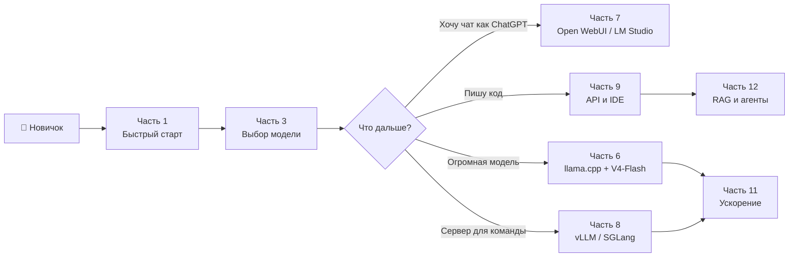

### 📊 DeepSeek в цифрах

| Показатель | Значение |
|---|---|
| Самая новая модель | **DeepSeek-V4.1-Flash-1017** (17.10.2026) |
| Самая большая модель | **DeepSeek-V4-Pro** — 1.6T параметров |
| Максимальный контекст | **1 048 576 токенов** (V4, V4.1) |
| Максимальная длина ответа | до **384K токенов** |
| Самая маленькая модель | **R1-Distill-Qwen-1.5B** — ~1 ГБ в Q4 |
| Лицензия весов | **MIT** (V3, R1, V4, V4.1) |
| Минимум для старта | любой ПК с 8 ГБ RAM |
| Команда для старта | `ollama run deepseek-r1:8b` |

---

## 📡 Топ ресурсы, чтобы следить за ИИ

| | Ресурс | Что внутри |
|---|---|---|
| [🧠](https://t.me/+-DTW9e5kyZ5jNGFi) | **[Machine Learning](https://t.me/+4vxN5vuxQXQ2NTky)** | Экспертный разбор ИИ-моделей и вся база для работы с ними: дайджесты лучших проектов, разбор кода, инструкции по запуску LLM, подготовка к собеседованиям и многое другое |
| [📚](https://t.me/+64ytM2_MgJozZTEy) | **[Data Science](https://t.me/+yLYl2dE5U8FjYzVi)** | Редкая литература, статьи, курсы и уникальные гайды для ML-специалистов любого уровня. Читайте, развивайтесь, практикуйте |
| 💼 | **[Machine Interview](https://t.me/+Gncl6NEJXOo4ODIy)** | База из [1900 вопросов с собеседований](https://t.me/+XKbJXlBwqBExOWEy) по машинному обучению. Изучите популярные вопросы, и оффер не заставит себя ждать |
| 🔝 | **[Папка ИИ-ресурсов](https://t.me/addlist/2Ls-snqEeytkMDgy)** | Здесь мы собрали целый кладезь полезных ИИ-ресурсов для прокачки |

---

## 🚀 Часть 1. Быстрый старт за 5 минут

### Шаг 1. Установи Ollama

| ОС | Как установить |
|---|---|
| **Windows 10/11** | Скачай `OllamaSetup.exe` с [ollama.com/download](https://ollama.com/download) и запусти |
| **macOS** | Скачай приложение с [ollama.com/download](https://ollama.com/download) или `brew install ollama` |
| **Linux** | `curl -fsSL https://ollama.com/install.sh \| sh` |

Проверь установку:

```bash
ollama --version
```

### Шаг 2. Запусти DeepSeek

```bash
ollama run deepseek-r1:8b
```

Первый запуск скачает модель (~5 ГБ). Потом можно писать вопросы прямо в терминале. Выход — `/bye`.

> 💡 Не знаешь, какой размер выбрать? Видеопамять 4–6 ГБ → `1.5b`/`7b`, 8 ГБ → `8b`, 12–16 ГБ → `14b`, 24 ГБ → `32b`. Подробнее — в [части 3](#-часть-3-какую-модель-deepseek-выбрать).

### Шаг 3. Поставь интерфейс как у ChatGPT (по желанию)

Нужен [Docker Desktop](https://www.docker.com/products/docker-desktop/):

```bash
docker run -d -p 3000:8080 --add-host=host.docker.internal:host-gateway \
  -v open-webui:/app/backend/data --name open-webui --restart always \
  ghcr.io/open-webui/open-webui:main
```

Открой `http://localhost:3000`, создай аккаунт администратора (он локальный) и выбери модель `deepseek-r1:8b`.

**Не хочешь терминал и Docker?** Поставь [LM Studio](https://lmstudio.ai): найди `deepseek` в поиске, скачай модель и общайся в окне программы.

### Схема: три пути к первому запуску

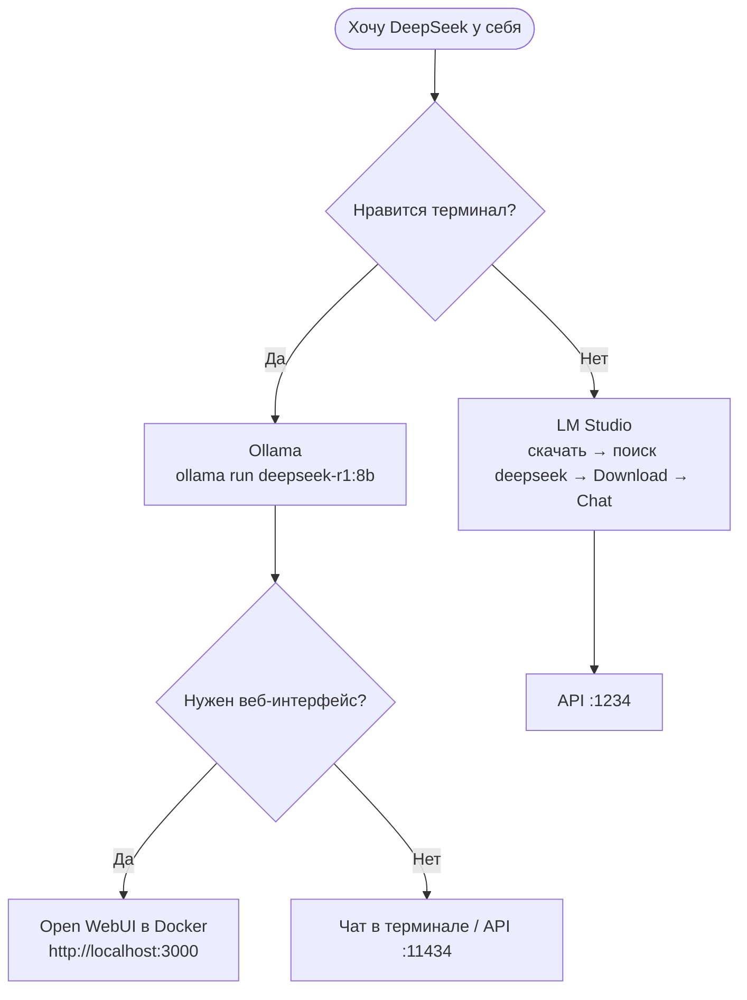

| Путь | Время | Сложность | Интерфейс | API |
|---|---|---|---|---|
| LM Studio | ~5 мин | ⭐ | окно программы | `:1234/v1` |
| Ollama | ~3 мин | ⭐ | терминал | `:11434/v1` |
| Ollama + Open WebUI | ~10 мин | ⭐⭐ | браузер | `:11434/v1` |
| llama.cpp | ~15 мин | ⭐⭐⭐ | браузер (`llama-server`) | `:8080/v1` |

---

## 🧠 Часть 2. Что такое DeepSeek и зачем запускать локально

**DeepSeek** — ИИ-лаборатория из Ханчжоу (Китай). Она публикует большие языковые модели с открытыми весами: их можно скачать и запускать где угодно, в том числе в коммерческих проектах (лицензия MIT).

### Хронология моделей

| Модель | Когда | Параметры (всего / активных) | Главное |
|---|---|---|---|
| DeepSeek-V2 | 2024 | 236B / 21B | MoE + Multi-head Latent Attention (сжатый KV-кэш) |
| DeepSeek-V3 | дек. 2024 | 671B / 37B | FP8-обучение, Multi-Token Prediction |
| **DeepSeek-R1** | янв. 2025 | 671B / 37B | «Думающая» модель, обучение через RL; дистилляты 1.5B–70B |
| V3.1 / V3.2 | 2025 | 671B / 37B | Гибридный режим: думает или отвечает сразу; разреженное внимание |
| **DeepSeek-V4-Flash** | апр. 2026 | 284B / 13B | Контекст 1M, режимы размышлений, MIT |
| **DeepSeek-V4-Pro** | апр. 2026 | 1.6T / 49B | Флагман, контекст 1M |
| V4-Flash-0731 / V4-Pro-0813 | июль–авг. 2026 | 284B / 13B и 1.6T / 49B | Обновлённые чекпойнты, зрелые GGUF от Unsloth |
| DeepSeek-V4.1-Flash | сент. 2026 | ~552B + 196B Engram / 8–16B | Encoder-decoder, ввод картинок, KV-кэш в 4 раза меньше |
| **DeepSeek-V4.1-Flash-1017** ⭐ | 17 окт. 2026 | то же | Последняя версия: сильнее в агентных задачах и коде, короче ответы |

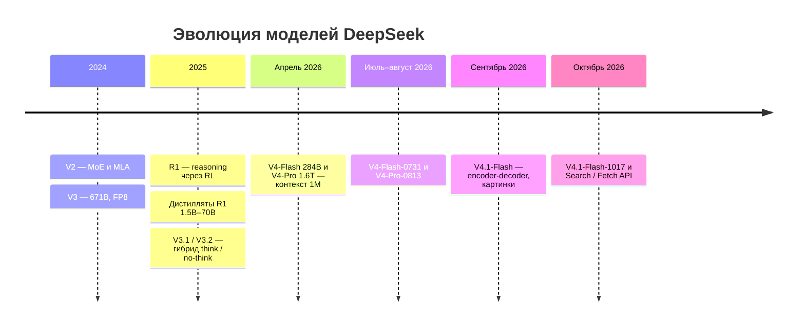

### Пять понятий, без которых не обойтись

**Как работает MoE (смесь экспертов):**

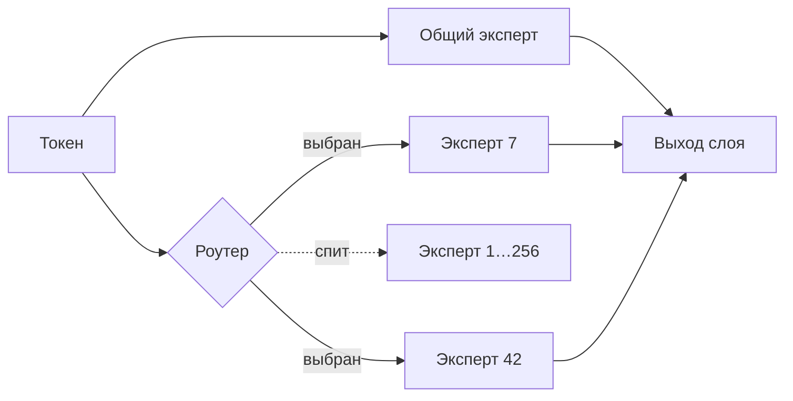

> Вся модель хранится в памяти, но считается только малая часть. Поэтому MoE нужно **много памяти**, но **мало вычислений**.

| | Обычная (dense) модель | MoE-модель |
|---|---|---|
| Пример | R1-Distill-Qwen-32B | V4-Flash 284B |
| Считается на токен | все 32B | ~13B |
| Нужно памяти | под 32B | под 284B |
| Скорость генерации | как у 32B | как у ~13B |
| Где выгодна | одна мощная GPU | много RAM + GPU, Mac с большой памятью |

- **MoE (Mixture of Experts, смесь экспертов).** Модель состоит из множества «экспертов», но на каждый токен работает лишь малая часть. V4-Flash весит 284B, а считает как ~13B. Поэтому **памяти нужно много, а вычислений мало**, и для MoE хорошо подходит связка «много RAM + одна видеокарта».
- **Режим размышлений (thinking).** Сначала модель пишет рассуждение (`<think>…</think>`), потом ответ. Так она лучше решает математику, код и логику, но ответ получается медленнее и тратит больше токенов.
- **Дистиллят.** Маленькая модель (Qwen или Llama), дообученная на ответах большой R1. Все `deepseek-r1:1.5b…70b` в Ollama — дистилляты.
- **Квантизация.** Сжатие весов с 16 до 8/4/3/2 бит. Q4 примерно в 4 раза меньше FP16 и почти не теряет в качестве.
- **GGUF.** Формат файлов модели для llama.cpp, Ollama и LM Studio. Квант виден в названии файла: `Q4_K_M`, `Q8_0`, `IQ3_XXS`.

### Зачем запускать DeepSeek у себя

| Плюс | Почему важно |
|---|---|
| 🔒 **Приватность** | Код, договоры, медицинские данные не покидают твой компьютер |
| 💸 **Бесплатно** | Никакой оплаты за токены и подписок |
| 🌐 **Офлайн** | Работает в самолёте, в закрытом контуре, при блокировках |
| 🛠 **Контроль** | Свои системные промпты, параметры, дообучение |
| ♾ **Без лимитов** | Никаких «вы исчерпали лимит сообщений» |

**Минусы:** нужно хорошее железо, маленькие модели слабее облачных флагманов, настройка требует времени.

---

## 🎯 Часть 3. Какую модель DeepSeek выбрать

### Таблица выбора по железу

| Модель | Параметры | Чем запускать | Память (Q4)* | Скорость** | Для чего |
|---|---|---|---|---|---|
| `deepseek-r1:1.5b` | 1.5B | Ollama, LM Studio | ~2 ГБ | очень быстро | Слабые ноутбуки, тесты |
| `deepseek-r1:7b` | 7B (Qwen) | Ollama, LM Studio | ~5 ГБ | быстро | Старт на слабой GPU |
| `deepseek-r1:8b` | 8B | Ollama, LM Studio | ~5–6 ГБ | быстро | **Лучший старт для большинства** |
| `deepseek-r1:14b` | 14B (Qwen) | Ollama, LM Studio | ~9–10 ГБ | средне | RTX 3060 12GB, 4060 Ti 16GB |
| `deepseek-r1:32b` | 32B (Qwen) | Ollama, llama.cpp | ~20 ГБ | средне | RTX 3090 / 4090 / 5090, Mac 32 ГБ+ |
| `deepseek-r1:70b` | 70B (Llama) | Ollama, llama.cpp | ~43 ГБ | медленно | 2×24 ГБ GPU, Mac 64 ГБ+ |
| `R1-0528-Qwen3-8B` | 8B | Ollama (`hf.co/...`), LM Studio | ~5 ГБ | быстро | Самый сильный дистиллят 8B |
| **DeepSeek-V4-Flash-0731** (GGUF) | 284B / 13B MoE | llama.cpp, ds4 (Mac) | ~103 ГБ (3 бит) | средне | Mac Studio 128 ГБ+, DGX Spark, ПК 128 ГБ RAM + GPU |
| **DeepSeek-V4.1-Flash-1017** ⭐ | ~552B + Engram / 8–16B | SGLang, vLLM; MLX (сообщество) | ~510 ГБ FP8; ~167 ГБ 2 бит | средне | 8× H100/H200; Mac Studio 256–512 ГБ |
| **DeepSeek-V4-Pro-0813** | 1.6T / 49B MoE | vLLM, SGLang | ~800 ГБ+ | — | Дата-центр (8× H200/B200) |
| Облако (`deepseek-v4.1-flash`, `:cloud`) | — | API DeepSeek, Ollama Cloud, OpenRouter | любой ПК | быстро | Когда своего железа нет |

\* Только веса. Под контекст нужно добавить память на KV-кэш (см. часть 4).
\*\* Если модель целиком помещается в видеопамять.

### Быстрое решение — схема выбора

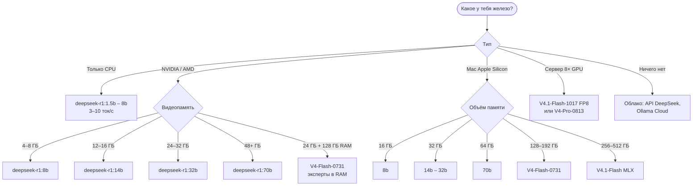

### Матрица «видеопамять × модель»

✅ — влезает целиком на GPU · ⚠️ — с частичным оффлоадом в RAM (медленнее) · ❌ — не запустится разумно

| VRAM ↓ / Модель → | 1.5B | 8B | 14B | 32B | 70B | V4-Flash |
|---|---|---|---|---|---|---|
| **4 ГБ** | ✅ | ⚠️ | ❌ | ❌ | ❌ | ❌ |
| **8 ГБ** | ✅ | ✅ | ⚠️ | ❌ | ❌ | ❌ |
| **12 ГБ** | ✅ | ✅ Q8 | ✅ | ⚠️ | ❌ | ❌ |
| **16 ГБ** | ✅ | ✅ Q8 | ✅ Q6 | ⚠️ | ❌ | ❌ |
| **24 ГБ** | ✅ | ✅ FP16 | ✅ Q8 | ✅ Q4 | ⚠️ | ⚠️ нужно 128 ГБ RAM |
| **32 ГБ** | ✅ | ✅ FP16 | ✅ Q8 | ✅ Q5–Q6 | ⚠️ | ⚠️ нужно 128 ГБ RAM |
| **48 ГБ** | ✅ | ✅ | ✅ FP16 | ✅ Q8 | ✅ Q4 | ⚠️ нужно 96+ ГБ RAM |
| **128 ГБ unified (Mac)** | ✅ | ✅ | ✅ | ✅ | ✅ Q8 | ✅ IQ3 |

### Модель под задачу

| Задача | Минимум | Оптимум | Режим размышлений |
|---|---|---|---|
| Чат, вопросы-ответы | R1 8B | R1 14B–32B / V4-Flash | выкл |
| Русский язык, тексты | R1 14B | R1 32B / V4-Flash | выкл |
| Программирование | R1 14B | V4-Flash / V4.1-Flash | вкл |
| Математика, логика | R1 8B | R1 32B / V4 | вкл (max) |
| Агенты, tool calling | R1 14B | V4.1-Flash-1017 | вкл |
| Анализ длинных документов | R1 14B + RAG | V4 / V4.1 (1M контекст) | вкл |
| Картинки на вход | — | V4.1-Flash | по задаче |
| Слабый ноутбук | R1 1.5B | R1-0528-Qwen3-8B | выкл |

### V4-Flash-0731 или V4.1-Flash-1017?

| | V4-Flash-0731 | V4.1-Flash-1017 |
|---|---|---|
| Размер весов | 284B (~103–162 ГБ в GGUF) | ~552B + 196B Engram (~510 ГБ FP8, ~167 ГБ в 2 бит) |
| Активных параметров | 13B | 8B prefill / 16B decode |
| Картинки на вход | только Vision-Exp | ✅ нативно |
| KV-кэш | компактный | ещё в ~4 раза меньше |
| llama.cpp / Ollama / LM Studio | ✅ (GGUF от Unsloth) | ❌ пока нет в основной ветке |
| Спекулятивное декодирование DSpark | ✅ | ❌ |
| Качество в агентных задачах и коде | хорошее | **лучшее у DeepSeek на октябрь 2026** |
| **Итог** | **Лучший выбор для дома** | Сервер, большой Mac или облако |

📖 Полный каталог всех версий и разновидностей с железом под каждую: [docs/15-modeli-i-zhelezo.md](docs/15-modeli-i-zhelezo.md)

> ⚠️ **Важно:** дистилляты R1 — это Qwen/Llama, обученные «думать как R1». Они хороши в математике и коде, но знаний и русского языка у них меньше, чем у полноразмерного DeepSeek. Для русского лучше брать **14B и выше**.

---

## 💾 Часть 4. Железо: сколько нужно памяти

### Формула

```
Память ≈ Параметры × (бит на вес / 8) + KV-кэш + 1–2 ГБ
```

| Модель | FP16 | Q8_0 | Q4_K_M | Q3 |
|---|---|---|---|---|
| 8B | 16 ГБ | 8.5 ГБ | ~5 ГБ | ~3.5 ГБ |
| 14B | 28 ГБ | 15 ГБ | ~9 ГБ | ~6.5 ГБ |
| 32B | 64 ГБ | 34 ГБ | ~20 ГБ | ~14 ГБ |
| 70B | 140 ГБ | 75 ГБ | ~43 ГБ | ~31 ГБ |
| V4-Flash 284B | — | ~162 ГБ | ~155 ГБ | ~103 ГБ |

### Из чего складывается потребление памяти (пример: 14B Q4, контекст 32K)

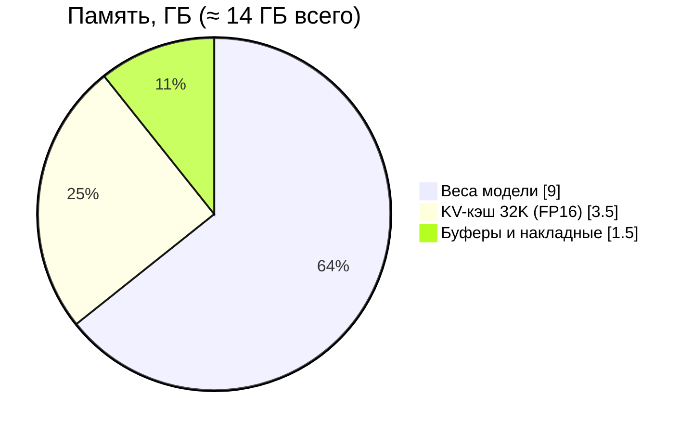

> Включи `OLLAMA_KV_CACHE_TYPE=q8_0`, и KV-кэш станет вдвое меньше: ~1.75 ГБ вместо 3.5.

### Сколько места на диске

| Модель | Q4 | Q8 | Оригинал |
|---|---|---|---|
| R1 8B | ~5 ГБ | ~8.5 ГБ | ~16 ГБ |
| R1 32B | ~20 ГБ | ~34 ГБ | ~65 ГБ |
| R1 70B | ~43 ГБ | ~75 ГБ | ~140 ГБ |
| V4-Flash-0731 | ~155 ГБ | ~162 ГБ | ~167 ГБ (FP4/FP8) |
| V4.1-Flash-1017 | — | — | ~510 ГБ (FP8) |
| V4-Pro | — | — | ~800+ ГБ |

### Какой квант брать

| Квант | Качество | Когда |
|---|---|---|
| `Q8_0` | ≈ оригинал | Память с запасом |
| `Q6_K` | отлично | 32B на 24+ ГБ |
| **`Q4_K_M` / `Q5_K_M`** | хорошо | **По умолчанию** |
| `IQ3_XXS` / `Q3_K_M` | заметные потери | Огромные модели (70B, V4-Flash) |
| `IQ2` / 1-бит | сильные потери | Лишь бы влезло (MoE переносят лучше) |

> 💡 **Правило:** большая модель в низком кванте почти всегда лучше маленькой в высоком. `32B-Q4` > `14B-Q8`. Но ниже 3 бит качество падает резко.

### Готовые конфигурации

| Бюджет | Что запустится |
|---|---|
| Ноутбук без GPU, 16 ГБ RAM | R1 1.5B–8B, 3–10 токенов/с |
| RTX 3060 12 ГБ / 4060 Ti 16 ГБ | R1 14B целиком на GPU, 30–50 ток/с |
| RTX 3090 / 4090 / 5090 | R1 32B Q4; 70B частично в RAM |
| MacBook / Mac mini 64 ГБ | R1 70B Q4 |
| Mac Studio 128–192 ГБ | **V4-Flash-0731** в Q3–Q8 |
| Mac Studio 256–512 ГБ | **V4.1-Flash** (MLX 2 бит ~167 ГБ; 4/8 бит ~430 ГБ) |
| ПК: 128–192 ГБ DDR5 + RTX 4090 | **V4-Flash** (эксперты MoE в RAM) |
| NVIDIA DGX Spark 128 ГБ | V4-Flash в 2–3-битных квантах |
| 8× H100 / H200 | **V4.1-Flash-1017** в FP8 (~510 ГБ) |
| 8× B200 / GB300 | V4-Pro-0813 в FP8 / NVFP4 |

### NVIDIA, AMD, Apple, Intel

- **NVIDIA (CUDA).** Лучшая поддержка: работает всё.
- **AMD.** Ollama и llama.cpp работают через ROCm (поддерживаемые карты) или Vulkan (почти все). vLLM работает на Instinct с ROCm.
- **Apple Silicon.** Благодаря единой памяти это самый дешёвый способ запустить огромную модель. Генерация быстрая, а длинный промпт обрабатывается медленнее, чем на NVIDIA.
- **Intel Arc.** Через Vulkan или SYCL в llama.cpp.

---

## 🦙 Часть 5. Ollama — установка и настройка

### Основные команды

```bash
ollama pull deepseek-r1:14b       # скачать модель
ollama run deepseek-r1:14b        # чат в терминале
ollama run deepseek-r1:14b --verbose   # + скорость в токенах/с
ollama list                       # установленные модели
ollama ps                         # что в памяти и на GPU или CPU
ollama stop deepseek-r1:14b       # выгрузить из памяти
ollama rm deepseek-r1:14b         # удалить
ollama show deepseek-r1:14b       # параметры, шаблон, лицензия
```

### Модели DeepSeek в Ollama

> V4.1-Flash локально в Ollama пока не запускается (архитектура `deepseek_v41` не поддерживается движком), доступна только облачно: `deepseek-v4.1-flash`.

- `deepseek-r1:1.5b`, `7b`, `8b`, `14b`, `32b`, `70b` — дистилляты, работают локально
- `deepseek-r1:671b` — полная R1 (нужно 400+ ГБ)
- `deepseek-v3`, `deepseek-v3.1`, `deepseek-coder-v2` — прошлые поколения
- `deepseek-v4-flash:cloud`, `deepseek-v4-pro:cloud` — **облачные** теги: модель работает на серверах ollama.com, веса не скачиваются (сначала `ollama signin`)

### Команды внутри чата

```
/set parameter num_ctx 16384      # размер контекста
/set parameter temperature 0.6    # температура
/set system "Отвечай только на русском языке."
/set think                        # включить размышления
/set nothink                      # выключить размышления
/save ds-ru                       # сохранить как новую модель
/bye                              # выход
```

### Свой Modelfile: «сборка» модели под себя

Создай файл `Modelfile`:

```dockerfile
FROM deepseek-r1:14b

PARAMETER num_ctx 16384
PARAMETER temperature 0.6
PARAMETER top_p 0.95
PARAMETER repeat_penalty 1.05
PARAMETER num_predict 4096

SYSTEM """Ты — полезный ассистент. Всегда отвечай на русском языке, кратко и по делу."""
```

```bash
ollama create ds-ru -f Modelfile
ollama run ds-ru
```

### Любая модель с Hugging Face

```bash
ollama run hf.co/unsloth/DeepSeek-R1-0528-Qwen3-8B-GGUF:Q4_K_M
```

Или из локального файла: в Modelfile пишешь `FROM ./model-Q4_K_M.gguf`.

### 🔥 Переменные окружения — главные настройки

| Переменная | Значение | Что даёт |
|---|---|---|
| `OLLAMA_CONTEXT_LENGTH` | `32768` | Контекст по умолчанию (стандартный маленький) |
| `OLLAMA_FLASH_ATTENTION` | `1` | Меньше памяти и быстрее |
| `OLLAMA_KV_CACHE_TYPE` | `q8_0` | KV-кэш вдвое меньше (нужен flash attention) |
| `OLLAMA_KEEP_ALIVE` | `-1` | Модель не выгружается из памяти |
| `OLLAMA_NUM_PARALLEL` | `4` | Параллельные запросы |
| `OLLAMA_MAX_LOADED_MODELS` | `2` | Несколько моделей одновременно |
| `OLLAMA_HOST` | `0.0.0.0:11434` | Доступ из локальной сети |
| `OLLAMA_MODELS` | `D:\ollama` | Хранить модели на другом диске |

**Как задать переменные:**

- **Windows:** Пуск → «Изменение системных переменных среды» → «Переменные среды» → «Создать». Потом перезапусти Ollama (иконка в трее → Quit → запусти снова).
- **macOS:** `launchctl setenv OLLAMA_FLASH_ATTENTION 1`, затем перезапусти приложение Ollama.
- **Linux:** `sudo systemctl edit ollama` и добавь:
  ```ini
  [Service]
  Environment="OLLAMA_FLASH_ATTENTION=1"
  Environment="OLLAMA_KV_CACHE_TYPE=q8_0"
  Environment="OLLAMA_CONTEXT_LENGTH=32768"
  Environment="OLLAMA_KEEP_ALIVE=-1"
  ```
  потом `sudo systemctl daemon-reload && sudo systemctl restart ollama`.

### Проверка, что всё работает быстро

```bash
ollama ps
```

В колонке `PROCESSOR` должно быть **`100% GPU`**. Если видишь `30%/70% CPU/GPU`, часть модели ушла в оперативную память и скорость упадёт в разы. Уменьши контекст или возьми модель меньше.

📖 Подробнее: [docs/03-ollama.md](docs/03-ollama.md)

### Как устроен Ollama

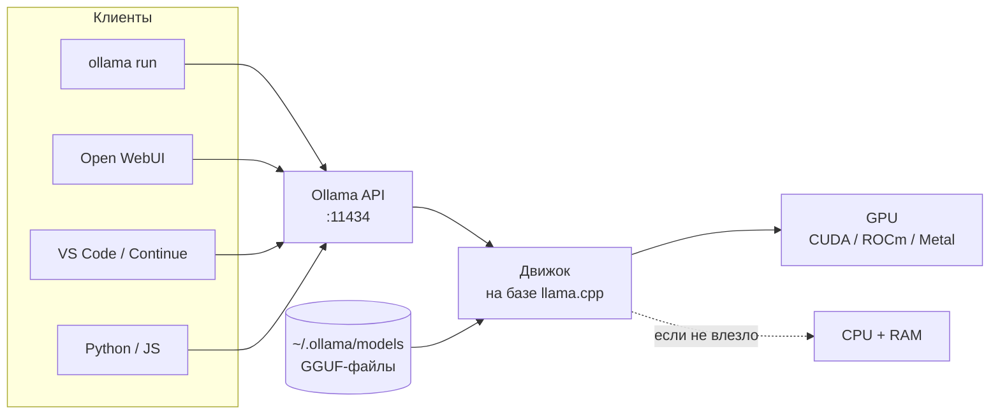

---

## ⚙️ Часть 6. llama.cpp и запуск DeepSeek V4-Flash

llama.cpp — движок, на котором построены Ollama и LM Studio. Он первым получает поддержку новых моделей и даёт полный контроль над тем, что лежит на GPU, а что в RAM.

### Установка

**Готовые сборки:** [GitHub Releases](https://github.com/ggml-org/llama.cpp/releases) (Windows, macOS, Linux), на Mac — `brew install llama.cpp`.

**Сборка из исходников:**

```bash
git clone https://github.com/ggml-org/llama.cpp
cd llama.cpp
cmake -B build -DGGML_CUDA=ON      # NVIDIA
# cmake -B build                   # Mac (Metal включён сам)
# cmake -B build -DGGML_VULKAN=ON  # AMD / Intel / любая GPU
cmake --build build --config Release -j
```

### Запуск дистиллята

```bash
llama-cli -hf unsloth/DeepSeek-R1-0528-Qwen3-8B-GGUF:Q4_K_M \
  -ngl 99 -c 16384 --temp 0.6 --top-p 0.95
```

### Запуск DeepSeek-V4-Flash (284B)

**1. Скачай квант** (~103 ГБ для 3-бит):

```bash
pip install -U huggingface_hub
hf download unsloth/DeepSeek-V4-Flash-0731-GGUF \
  --local-dir models/V4-Flash --include "*UD-IQ3_XXS*"
```

**2а. Mac Studio / DGX Spark** (вся модель в единой памяти):

```bash
llama-server \
  -m models/V4-Flash/UD-IQ3_XXS/DeepSeek-V4-Flash-0731-UD-IQ3_XXS-00001-of-00004.gguf \
  -ngl 99 -c 32768 --temp 1.0 --top-p 1.0 --min-p 0.01 --jinja
```

**2б. Обычный ПК: одна GPU 24 ГБ + 128 ГБ RAM** 🔥

```bash
llama-server \
  -m models/V4-Flash/UD-IQ3_XXS/DeepSeek-V4-Flash-0731-UD-IQ3_XXS-00001-of-00004.gguf \
  -ngl 99 -ot ".ffn_.*_exps.=CPU" \
  -c 32768 -t 16 -fa on \
  --cache-type-k q8_0 --cache-type-v q8_0 \
  --temp 1.0 --top-p 1.0 --min-p 0.01 --jinja
```

**Как это работает.** `-ngl 99` отправляет все слои на GPU, а `-ot` (override-tensor) возвращает тяжёлых «экспертов» MoE в оперативную память. На видеокарте остаются внимание и общие слои, то есть то, что считается на каждом токене. Так модель на 284B работает с одной игровой картой.

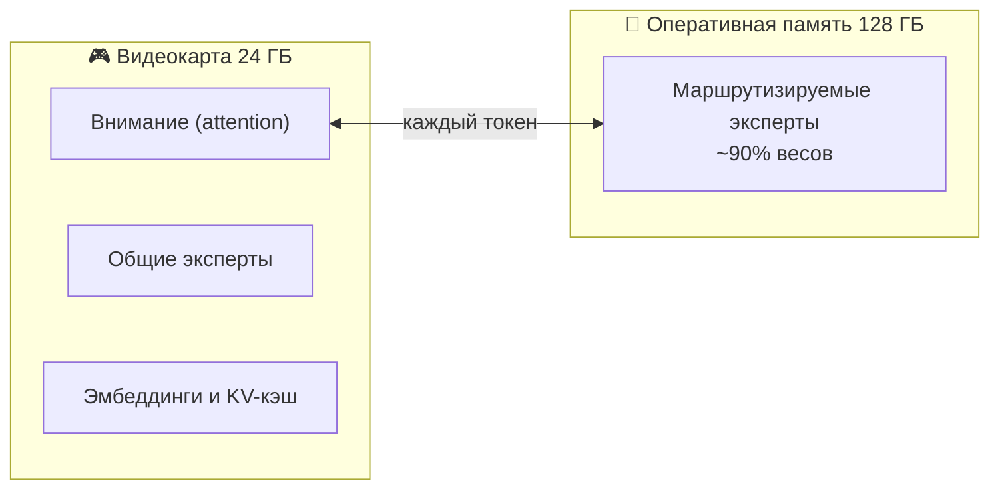

| Стратегия размещения | Флаги | Скорость | Когда |
|---|---|---|---|
| Всё на GPU | `-ngl 99` | ★★★★★ | Модель целиком влезает в VRAM |
| Эксперты в RAM | `-ngl 99 -ot ".ffn_.*_exps.=CPU"` | ★★★ | MoE больше VRAM (V4-Flash) |
| Часть экспертов на GPU | `-ot "blk\.([0-9])\.ffn_.*_exps.=CUDA0" -ot ".ffn_.*_exps.=CPU"` | ★★★★ | Осталась свободная VRAM |
| N слоёв на GPU | `-ngl 30` | ★★ | Dense-модели больше VRAM |
| Только CPU | без `-ngl` | ★ | Нет GPU |

> Указывай **первый** файл из частей (`-00001-of-0000N`), остальные подхватятся сами. Названия чекпойнтов меняются, поэтому актуальные смотри на [странице Unsloth](https://unsloth.ai/docs/models/deepseek-v4).

### Режимы размышлений V4

```bash
--reasoning off                                      # отвечать сразу
--chat-template-kwargs '{"enable_thinking":false}'  # то же через шаблон
--chat-template-kwargs '{"reasoning_effort":"max"}' # максимум размышлений
```

### Спекулятивное декодирование (до 2× быстрее)

```bash
llama-cli -m <V4-Flash-00001-of-0000N.gguf> \
  -md dspark-DeepSeek-V4-Flash-0731-Q8_0.gguf \
  --spec-type draft-dspark --spec-draft-n-max 3 \
  -ngl 99 -ngld 99 --temp 1.0 --top-p 1.0 --min-p 0.01
```

Маленький драфтер угадывает несколько токенов вперёд, а большая модель их проверяет. По данным Unsloth это ускоряет генерацию в 1.5–2 раза и требует ~10 ГБ дополнительной памяти.

### Шпаргалка флагов

| Флаг | Смысл |
|---|---|
| `-m` / `-hf repo:quant` | Файл модели / скачать с Hugging Face |
| `-ngl 99` | Все слои на GPU |
| `-ot "regex=CPU"` | Куда положить конкретные тензоры |
| `-c 32768` | Размер контекста |
| `-t 16` | Потоки = физические ядра CPU |
| `-fa on` | Flash attention |
| `--cache-type-k/v q8_0` | Сжатый KV-кэш |
| `-np 4` | Параллельные слоты в `llama-server` |
| `--jinja` | Шаблон чата из GGUF (нужен для tool calling) |
| `--api-key KEY` | Пароль на API |
| `-b 2048 -ub 2048` | Быстрее обработка длинных промптов |

`llama-server` сразу даёт **веб-чат** на `http://localhost:8080` и **OpenAI-совместимый API** на `http://localhost:8080/v1`.

📖 Подробнее: [docs/04-llama-cpp.md](docs/04-llama-cpp.md)

---

## 🖥 Часть 7. LM Studio, Open WebUI и другие интерфейсы

### LM Studio — проще всего для новичка

1. Скачай с [lmstudio.ai](https://lmstudio.ai) (Windows, macOS, Linux).
2. Открой поиск 🔍, введи `deepseek`, выбери модель и квант. Зелёная метка означает, что модель поместится в твою видеокарту.
3. Чатись во вкладке Chat, а во вкладке **Developer → Start Server** включается API на `http://localhost:1234/v1`.

**Фишки:** на Mac есть движок MLX (часто быстрее GGUF), ползунок «сколько слоёв на GPU» и CLI `lms` для скриптов.

### Open WebUI — свой ChatGPT для себя и команды

Возможности: история чатов, загрузка документов (RAG), веб-поиск, голосовой ввод, несколько пользователей с ролями.

**Всё в одном (Ollama + Open WebUI) через docker compose:**

```yaml
services:
  ollama:
    image: ollama/ollama:latest
    volumes: [ollama:/root/.ollama]
    environment:
      - OLLAMA_FLASH_ATTENTION=1
      - OLLAMA_KV_CACHE_TYPE=q8_0
      - OLLAMA_CONTEXT_LENGTH=16384
    deploy:
      resources:
        reservations:
          devices: [{driver: nvidia, count: all, capabilities: [gpu]}]
  open-webui:
    image: ghcr.io/open-webui/open-webui:main
    ports: ["127.0.0.1:3000:8080"]
    environment: [OLLAMA_BASE_URL=http://ollama:11434]
    volumes: [open-webui:/app/backend/data]
volumes: {ollama: {}, open-webui: {}}
```

```bash
docker compose up -d
docker compose exec ollama ollama pull deepseek-r1:14b
```

Готовый файл: [configs/docker-compose.yml](configs/docker-compose.yml).

**Подключить llama.cpp или vLLM вместо Ollama:** Admin Panel → Settings → Connections → OpenAI API → URL `http://host.docker.internal:8080/v1`.

**Фишки Open WebUI:**

- рассуждения модели сворачиваются в блок «Думал N секунд»;
- `#` в поле ввода прикрепляет документ или ссылку;
- **Workspace → Models**: своя «персона» поверх DeepSeek с системным промптом;
- **Workspace → Knowledge**: база документов для всех чатов;
- **Arena**: слепое сравнение двух моделей.

### Другие варианты

| Возможность | LM Studio | Open WebUI | Jan | AnythingLLM | llama-server UI |
|---|---|---|---|---|---|
| Установка без Docker | ✅ | ⚠️ (pip) | ✅ | ✅ | ✅ |
| Скачивание моделей из UI | ✅ | ✅ (через Ollama) | ✅ | ✅ | ❌ |
| Чат с документами (RAG) | ⚠️ базово | ✅ | ⚠️ | ✅ | ❌ |
| Веб-поиск | ❌ | ✅ | ⚠️ | ✅ | ❌ |
| Несколько пользователей | ❌ | ✅ | ❌ | ✅ | ❌ |
| Показ рассуждений `<think>` | ✅ | ✅ | ✅ | ✅ | ✅ |
| OpenAI-совместимый сервер | ✅ | ✅ | ✅ | ✅ | ✅ |
| Открытый исходный код | ❌ | ✅ | ✅ | ✅ | ✅ |


| Программа | Чем хороша |
|---|---|
| [Jan](https://jan.ai) | Открытая альтернатива LM Studio, полностью офлайн |
| AnythingLLM | Работа с документами и «рабочими пространствами» |
| LibreChat | Клон интерфейса ChatGPT, много провайдеров |
| Msty | Параллельные чаты с разными моделями |
| Page Assist | Расширение браузера: чат с открытой страницей через Ollama |

📖 Подробнее: [docs/06-interfeisy.md](docs/06-interfeisy.md)

---

## 🏭 Часть 8. vLLM и SGLang — сервер для команды

Ollama и llama.cpp рассчитаны на одного пользователя. Если запросы идут от 5+ человек одновременно, нужны движки с **continuous batching**: vLLM или SGLang. Их суммарная пропускная способность в разы выше.

### vLLM

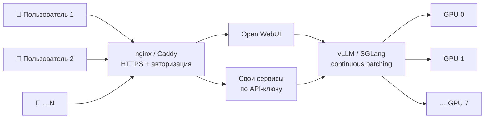

| | Ollama | llama.cpp server | vLLM | SGLang |
|---|---|---|---|---|
| 1 пользователь | ★★★★ | ★★★★★ | ★★★★ | ★★★★ |
| 10+ пользователей | ★★ | ★★★ | ★★★★★ | ★★★★★ |
| Мульти-GPU | ⚠️ базово | ✅ split | ✅ TP/PP/EP | ✅ TP/DP/EP |
| CPU + GPU гибрид | ✅ | ✅ лучший | ❌ | ❌ |
| GGUF | ✅ | ✅ | ⚠️ | ⚠️ |
| Safetensors / FP8 / FP4 | ❌ | ❌ | ✅ | ✅ |
| V4.1-Flash | ❌ | ❌ | ✅ (свежие версии) | ✅ (свежие версии) |
| Метрики Prometheus | ❌ | ✅ | ✅ | ✅ |


```bash
pip install -U vllm

vllm serve deepseek-ai/DeepSeek-R1-Distill-Qwen-32B \
  --tensor-parallel-size 2 \
  --max-model-len 32768 \
  --gpu-memory-utilization 0.92 \
  --reasoning-parser deepseek_r1 \
  --api-key change-me
```

`--reasoning-parser` выносит рассуждения в поле `reasoning_content`, так что в `content` остаётся только ответ.

### SGLang (лучше всего оптимизирован под архитектуру DeepSeek)

```bash
pip install -U "sglang[all]"
python3 -m sglang.launch_server \
  --model-path deepseek-ai/DeepSeek-V4-Flash --tp 8 --trust-remote-code \
  --host 0.0.0.0 --port 30000
```

### Главные параметры

| Что | vLLM | SGLang |
|---|---|---|
| Число GPU | `--tensor-parallel-size N` | `--tp N` |
| Макс. контекст | `--max-model-len` | `--context-length` |
| Доля VRAM | `--gpu-memory-utilization 0.9` | `--mem-fraction-static 0.9` |
| FP8 KV-кэш | `--kv-cache-dtype fp8` | `--kv-cache-dtype fp8_e5m2` |
| Экспертный параллелизм | `--enable-expert-parallel` | `--ep N` |

> ⚠️ Поддержка V4 зависит от версии движка и поколения GPU (Hopper/Blackwell). Сверяйся с карточкой модели и [рецептами vLLM](https://docs.vllm.ai/projects/recipes/).

📖 Подробнее: [docs/05-vllm-sglang.md](docs/05-vllm-sglang.md)

---

## 🔌 Часть 9. API, Python и подключение к IDE

Все движки отдают **OpenAI-совместимый API**, поэтому код один и тот же, меняется только адрес:

| Бэкенд | `base_url` |
|---|---|
| Ollama | `http://localhost:11434/v1` |
| llama-server | `http://localhost:8080/v1` |
| LM Studio | `http://localhost:1234/v1` |
| vLLM | `http://localhost:8000/v1` |
| SGLang | `http://localhost:30000/v1` |
| Облачный API DeepSeek | `https://api.deepseek.com` |

### Python

```python
from openai import OpenAI  # pip install openai

client = OpenAI(base_url="http://localhost:11434/v1", api_key="ollama")

resp = client.chat.completions.create(
    model="deepseek-r1:14b",
    messages=[
        {"role": "system", "content": "Отвечай на русском."},
        {"role": "user", "content": "Объясни MoE простыми словами."},
    ],
    temperature=0.6,
)
print(resp.choices[0].message.content)
```

### Стриминг (ответ печатается по мере генерации)

```python
for chunk in client.chat.completions.create(
    model="deepseek-r1:14b",
    messages=[{"role": "user", "content": "Напиши хайку про кита"}],
    stream=True,
):
    print(chunk.choices[0].delta.content or "", end="", flush=True)
```

### JavaScript

```js
import OpenAI from "openai";
const client = new OpenAI({ baseURL: "http://localhost:11434/v1", apiKey: "ollama" });
const r = await client.chat.completions.create({
  model: "deepseek-r1:8b",
  messages: [{ role: "user", content: "Привет!" }],
});
console.log(r.choices[0].message.content);
```

### Гарантированный JSON (structured output в Ollama)

```python
import requests
r = requests.post("http://localhost:11434/api/chat", json={
    "model": "deepseek-r1:14b",
    "messages": [{"role": "user", "content": "Иван, 29 лет, знает Python и Rust"}],
    "format": {
        "type": "object",
        "properties": {
            "name": {"type": "string"},
            "age": {"type": "integer"},
            "skills": {"type": "array", "items": {"type": "string"}},
        },
        "required": ["name", "age", "skills"],
    },
    "think": False,
    "stream": False,
})
print(r.json()["message"]["content"])  # {"name":"Иван","age":29,"skills":["Python","Rust"]}
```

### Бесплатный ИИ-помощник для кода в VS Code

| Расширение | Что умеет | Как подключить |
|---|---|---|
| **Continue** | Чат, автодополнение, правки | Провайдер `ollama`, модель `deepseek-r1:14b` |
| **Cline / Roo Code / Kilo Code** | Агент: сам читает и правит файлы, запускает команды | Провайдер `Ollama` или `OpenAI Compatible` + `base_url` |
| **Aider / OpenCode** (терминал) | Агент для git-репозиториев | OpenAI-совместимый `base_url` |

> Агентам нужна модель с надёжным tool calling и контекстом от 32K: R1 14B+ или V4-Flash.

### Облачный API DeepSeek (если не хватает железа)

```python
client = OpenAI(base_url="https://api.deepseek.com", api_key="sk-...")
client.chat.completions.create(model="deepseek-v4-flash", messages=[...])
```

Модели: `deepseek-flash` (сейчас ведёт на V4.1-Flash) и `deepseek-v4-pro`. Старые имена `deepseek-chat` и `deepseek-reasoner` выведены из эксплуатации. API также совместим с форматами Anthropic и OpenAI Responses. Цены и актуальные имена смотри на [api-docs.deepseek.com](https://api-docs.deepseek.com).

### 🔎 Новое: DeepSeek Search и Fetch API (веб-поиск для агентов)

С октября 2026 у DeepSeek есть официальные [Search и Fetch API](https://api-docs.deepseek.com/guides/search): поиск по вебу и загрузка страниц в Markdown. Цена — $0.75 за 1000 успешных запросов (пустые и ошибки бесплатно), лимит — 5 запросов/с.

```python
import os, requests
H = {"Authorization": f"Bearer {os.environ['DEEPSEEK_API_KEY']}"}

res = requests.post("https://api.deepseek.com/v1/tools/search", headers=H, json={
    "query": "DeepSeek V4.1 site:huggingface.co after:2026-09-01",
    "count": 5,
}).json()["results"]
for x in res:
    print(x["rerank_score"], x["title"], x["url"])   # + summary, content, date, authority

page = requests.post("https://api.deepseek.com/v1/tools/fetch", headers=H,
                     json={"url": res[0]["url"]}).json()
print(page["content"][:500])                          # Markdown страницы
```

Операторы запроса: `site:`, `-site:`, `"фраза"`, `-слово`, `lang:ru,en`, `after:` и `before:`.

**Фишка:** подключи Search как tool к **локальному** DeepSeek в Ollama. Модель работает у тебя, а свежие факты берутся из веба. Готовый агент: [examples/web_search_agent.py](examples/web_search_agent.py).

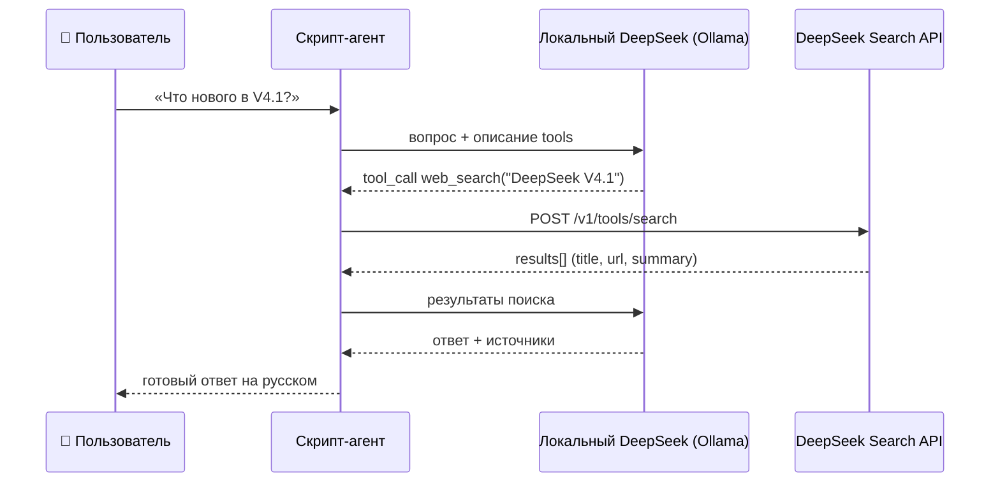

| API | Эндпоинт | Что возвращает | Цена | Лимит |
|---|---|---|---|---|
| Chat | `POST /chat/completions` | ответ модели | за токены | по тарифу |
| Search | `POST /v1/tools/search` | список страниц с `summary`, `rerank_score` | $0.75 / 1000 | 5 QPS |
| Fetch | `POST /v1/tools/fetch` | страница в Markdown | $0.75 / 1000 | 5 QPS + на домен |

📖 Подробнее и больше примеров: [docs/07-api-i-integracii.md](docs/07-api-i-integracii.md), [examples/](examples/)

---

## ✍️ Часть 10. Промптинг DeepSeek

### Параметры генерации

| Модель | temperature | top_p | Примечание |
|---|---|---|---|
| R1 и дистилляты | **0.6** (0.5–0.7) | 0.95 | Ниже 0.5 начинаются повторы и зацикливание |
| V4 Flash / Pro | **1.0** | 1.0 (агенты 0.95) | `min_p 0.01` в llama.cpp |
| JSON, классификация, код без размышлений | 0–0.3 | 0.9 | `think: false` |

### Правила для «думающих» моделей

1. **Не пиши «думай пошагово»**: модель и так рассуждает. Лучше опиши задачу и критерии хорошего ответа.
2. **Всё в одном сообщении:** сначала контекст, потом задача, в конце формат ответа.
3. **Для R1** держи важные инструкции в сообщении пользователя, а системный промпт короткий или пустой.
4. **Для математики:** «Рассуждай пошагово, итоговый ответ помести в `\boxed{}`».
5. **Few-shot часто мешает** reasoning-моделям, поэтому начинай без примеров.
6. **Ограничивай длину** (`num_predict` / `max_tokens`), иначе модель может думать тысячи токенов.
7. **Длинный документ ставь в начало, вопрос в конец.**

### Когда включать размышления

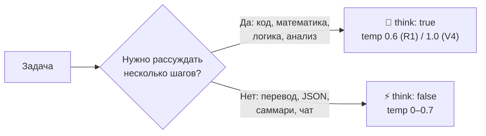

| Задача | Режим |
|---|---|
| Математика, логика, алгоритмы, отладка кода | ✅ думать (V4: high или max) |
| Анализ сложного документа | ✅ думать |
| Перевод, пересказ, саммари | ❌ не думать |
| Извлечение данных в JSON, классификация | ❌ не думать |
| Обычный чат | ❌ не думать |

### Готовые шаблоны

**Строгий русский язык:**

```
Ты отвечаешь ТОЛЬКО на русском языке, даже если вопрос на другом языке.
Если не знаешь ответа — честно скажи.
```

**Код-ревью:**

```
Проведи ревью кода. Найди: 1) баги, 2) уязвимости, 3) проблемы производительности.
Для каждой: строка, суть, исправленный фрагмент. В конце — оценка 1–10.
<код>
...
</код>
```

**Извлечение данных:**

```
Извлеки все компании и суммы сделок.
Верни ТОЛЬКО JSON-массив [{"company": str, "amount_rub": number}] без пояснений.
Текст: ...
```

**Анализ договора (V4, контекст 1M):**

```
<документ>
...весь договор...
</документ>
Найди пункты, невыгодные Исполнителю. Для каждого: цитата, риск, новая формулировка.
```

### Убираем `<think>` из ответа и истории

```python
import re
answer = re.sub(r"<think>.*?</think>", "", text, flags=re.S).strip()
```

В историю диалога клади только `answer`. Так экономится контекст, и модель не залипает на старых рассуждениях.

📖 Подробнее: [docs/08-promptting.md](docs/08-promptting.md)

---

## ⚡ Часть 11. Ускорение и оптимизация

**Две скорости:**

- **prefill (pp)**: как быстро модель читает промпт; упирается в вычисления GPU;
- **generation (tg)**: как быстро пишет ответ; упирается в пропускную способность памяти.

**Оценка потолка скорости генерации:**

```
токенов/с ≈ пропускная способность памяти (ГБ/с) ÷ размер активных весов (ГБ)
```

Пример: RTX 4090 (~1000 ГБ/с) с моделью 14B-Q4 (~9 ГБ) в теории даёт ~110 ток/с, на практике 60–80. Для MoE считаются только **активные** веса, поэтому V4-Flash (13B активных) остаётся быстрой даже частично из RAM.

### Чек-лист ускорения (по убыванию эффекта)

### Ориентировочная скорость генерации

> Порядок величин по замерам сообщества (Q4, короткий контекст, вся модель на GPU, если не сказано иное). Твои цифры будут отличаться. Присылай свои замеры через [Issue](https://github.com/justxor/deepseek-local-guide-ru/issues/new?template=benchmark.md).

| Железо | R1 8B | R1 14B | R1 32B | R1 70B | V4-Flash / V4.1-Flash |
|---|---|---|---|---|---|
| CPU, DDR5 2 канала | 8–12 | 4–7 | 2–3 | ~1 | — |
| RTX 3060 12 ГБ | 50–60 | 30–35 | ⚠️ | ❌ | ❌ |
| RTX 4090 24 ГБ | 110–130 | 70–80 | 35–40 | ⚠️ 3–8 | ⚠️ с 128 ГБ RAM |
| RTX 5090 32 ГБ | 150+ | 90–110 | 50–60 | ⚠️ | ⚠️ с 128 ГБ RAM |
| Mac M3/M4 Max 64–128 ГБ | 60–80 | 35–45 | 18–25 | 8–12 | V4-Flash IQ3 на 128 ГБ |
| DGX Spark 128 ГБ | — | — | — | — | V4-Flash IQ2: **6–7** |
| Mac Studio M3 Ultra 256 ГБ | — | — | — | — | V4.1-Flash MLX 2 бит: **~9.5** |


1. ✅ Вся модель на GPU (`ollama ps` → `100% GPU`, в llama.cpp `-ngl 99`).
2. ✅ Квант поменьше (Q4 вместо Q8) почти линейно ускоряет генерацию.
3. ✅ Для MoE держи экспертов в RAM, а остальное на GPU (`-ot ".ffn_.*_exps.=CPU"`).
4. ✅ Flash attention (`-fa on` или `OLLAMA_FLASH_ATTENTION=1`).
5. ✅ KV-кэш в `q8_0` освобождает VRAM под слои.
6. ✅ Спекулятивное декодирование (драфтер) даёт 1.5–2× на генерации.
7. ✅ Потоки = физические ядра (на Intel только P-ядра).
8. ✅ Больше батч (`-b 2048 -ub 2048`) ускоряет длинные промпты.
9. ✅ Неизменный системный промпт: включается кэш префикса.
10. ✅ Для CPU-инференса важна быстрая RAM (DDR5, заняты все каналы).

### Mac: дать GPU больше памяти

```bash
sudo sysctl iogpu.wired_limit_mb=122880   # пример для Mac со 128 ГБ
```

Настройка сбрасывается после перезагрузки. Оставь системе 8–16 ГБ.

### Замер скорости

```bash
ollama run deepseek-r1:8b --verbose          # eval rate = токенов/с
llama-bench -m model.gguf -ngl 99 -fa 1      # pp и tg
```

📖 Подробнее: [docs/09-optimizaciya.md](docs/09-optimizaciya.md)

---

## 📚 Часть 12. RAG и агенты

### RAG: чат со своими документами

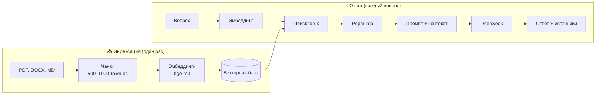

| Компонент | Простой вариант | Продвинутый вариант |
|---|---|---|
| Эмбеддинги | `bge-m3` в Ollama | `multilingual-e5-large`, `bge-m3` в vLLM |
| Векторная база | numpy в памяти | Qdrant, Chroma, pgvector |
| Поиск | косинусная близость | гибрид BM25 + векторы |
| Реранкер | нет | `bge-reranker-v2-m3` |
| Модель | R1 14B | V4-Flash / V4.1-Flash |
| Интерфейс | скрипт | Open WebUI Knowledge, AnythingLLM |

**Без кода:** Open WebUI → Workspace → Knowledge → загрузи PDF или DOCX, затем в чате введи `#` и выбери базу.

**На Python:** [examples/rag_minimal.py](examples/rag_minimal.py)

```bash
ollama pull bge-m3            # эмбеддинги, хорошо понимают русский
ollama pull deepseek-r1:14b
python examples/rag_minimal.py --docs ./my_docs --question "Какой срок оплаты?"
```

**Как сделать RAG точнее:**

- эмбеддинги для русского: `bge-m3` или `multilingual-e5-large`;
- чанки по 500–1000 токенов с перекрытием 10–20%;
- реранкер (`bge-reranker-v2-m3`) после поиска;
- гибридный поиск (BM25 + векторы) для терминов, артикулов и имён;
- проси модель указывать источник для каждого факта;
- с V4 и контекстом 1M небольшую базу можно положить в промпт целиком, без RAG.

### Tool calling: модель вызывает твои функции

```python
tools = [{
  "type": "function",
  "function": {
    "name": "get_weather",
    "description": "Погода в городе",
    "parameters": {"type": "object",
                   "properties": {"city": {"type": "string"}},
                   "required": ["city"]}
  }
}]
resp = client.chat.completions.create(model="deepseek-r1:14b", messages=msgs, tools=tools)
print(resp.choices[0].message.tool_calls)
```

Полный цикл «модель → функция → модель»: [examples/tool_calling.py](examples/tool_calling.py).

### Фреймворки

| Фреймворк | Подключение |
|---|---|
| LangChain / LangGraph | `ChatOllama(model="deepseek-r1:14b")` |
| LlamaIndex | `Ollama(model="deepseek-r1:14b")` |
| CrewAI | `LLM(model="ollama/deepseek-r1:14b")` |
| smolagents | `OpenAIServerModel(api_base="http://localhost:11434/v1", ...)` |

**Паттерн «планировщик + исполнитель»:** думающая модель один раз раскладывает задачу на шаги, а быстрая (no-think) выполняет их и вызывает инструменты. Получается дешевле и быстрее.

📖 Подробнее: [docs/10-rag-i-agenty.md](docs/10-rag-i-agenty.md)

---

## 🎓 Часть 13. Дообучение (fine-tuning)

Дообучение нужно, когда модель должна усвоить **стиль, формат или узкую предметную область**. Если задача в том, чтобы модель знала **факты** из твоих документов, сначала попробуй RAG.

**Самый доступный способ:** QLoRA через [Unsloth](https://github.com/unslothai/unsloth) на дистилляте R1.

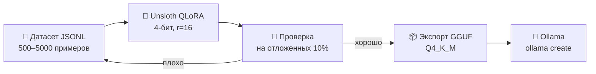

| Метод | VRAM для 14B | Качество | Скорость обучения |
|---|---|---|---|
| Полное дообучение | 200+ ГБ | ★★★★★ | медленно |
| LoRA (16 бит) | ~35 ГБ | ★★★★ | средне |
| **QLoRA (4 бит)** | **~12–16 ГБ** | ★★★★ | **быстро** |

| Модель | VRAM для QLoRA (ориентир) |
|---|---|
| R1-Distill 1.5B–8B | 6–12 ГБ |
| R1-Distill 14B | 12–16 ГБ |
| R1-Distill 32B | 24+ ГБ |

**План:**

1. Собери 500–5000 примеров «вопрос → идеальный ответ» в JSONL (для reasoning-моделей с рассуждением).
2. Обучи LoRA-адаптер в Unsloth (есть бесплатные ноутбуки для Colab).
3. Экспортируй в GGUF (`model.save_pretrained_gguf(...)`).
4. Подключи в Ollama через Modelfile: `FROM ./my-model-Q4_K_M.gguf`.

📖 Пошагово: [docs/13-fine-tuning.md](docs/13-fine-tuning.md)

---

## 🔥 Часть 14. Топ-30 фишек и приёмов

**Память и запуск**

1. **Квант `Q4_K_M` по умолчанию**, `Q5_K_M` при запасе памяти, `Q8_0` — почти без потерь.
2. **Динамические кванты Unsloth (`UD-*`)**: важные слои остаются точными, поэтому V4-Flash в 3 битах влезает в ~110 ГБ.
3. **Эксперты MoE в RAM:** `-ot ".ffn_.*_exps.=CPU"` позволяет запустить 284B-модель на одной GPU.
4. **Явно увеличь контекст в Ollama:** `OLLAMA_CONTEXT_LENGTH=32768`, стандартного не хватает для документов.
5. **Сожми KV-кэш:** `OLLAMA_KV_CACHE_TYPE=q8_0` + `OLLAMA_FLASH_ATTENTION=1`.
6. **`OLLAMA_KEEP_ALIVE=-1`** убирает задержку перед первым ответом.
7. **Mac:** `sudo sysctl iogpu.wired_limit_mb=…` открывает GPU больше памяти.
8. **Модели на другой диск:** `OLLAMA_MODELS=D:\ollama` (они занимают десятки гигабайт).

**Качество**

9. **R1: temperature 0.6**, а не 0. Иначе модель зацикливается.
10. **V4: temperature 1.0, top_p 1.0.**
11. **R1:** инструкции в сообщении пользователя, системный промпт минимальный.
12. **Математика:** «ответ помести в `\boxed{}`».
13. **Отключай размышления там, где они не нужны:** `/set nothink`, `"think": false`, `--reasoning off`.
14. **`reasoning_effort: "max"`** у V4 для самых сложных задач (нужен большой контекст).
15. **Вырезай `<think>` из истории диалога.**
16. **JSON Schema в `format`** даёт гарантированно валидный JSON.
17. **Для русского бери 14B+**, маленькие дистилляты срываются на английский и китайский.
18. **Длинный документ в начало промпта, вопрос в конец.**

**Скорость**

19. **Спекулятивное декодирование** (DSpark для V4-Flash): 1.5–2×.
20. **`-ngl 99`**: каждый слой в RAM сильно замедляет.
21. **Потоки = физические ядра**, а не логические.
22. **`--mlock`**, если система «свопает» модель.
23. **vLLM или SGLang** для нескольких пользователей: continuous batching даёт кратный прирост.
24. **Не меняй системный промпт между запросами**, тогда работает кэш префикса.

**Интеграции**

25. **Любой клиент OpenAI** работает с локальной моделью через `base_url`.
26. **Continue или Cline в VS Code** + DeepSeek дают бесплатного приватного Copilot.
27. **Open WebUI + Knowledge** — RAG без единой строчки кода.
28. **Один код для облака и локалки:** меняется только `base_url`.
29. **`docker compose up -d`** поднимает весь стек одной командой.
30. **Никогда не открывай порт 11434 в интернет**: у API Ollama нет пароля.

---

## 🛠 Часть 15. Ошибки и их решение

### Схема: «DeepSeek работает медленно»

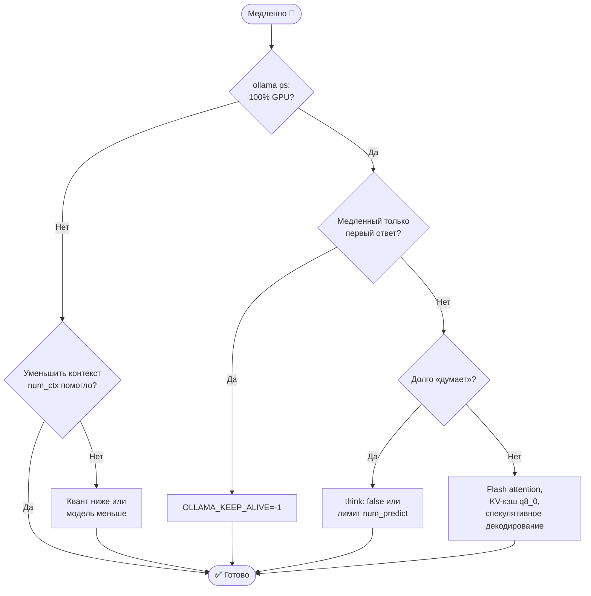


| Симптом | Причина | Решение |
|---|---|---|
| `CUDA out of memory` | Модель или контекст не помещаются | Меньше квант, меньше `num_ctx`, KV-кэш `q8_0`, часть слоёв на CPU |
| 1–3 токена/с на видеокарте | Модель ушла в RAM | `ollama ps` → должно быть `100% GPU`; уменьши контекст или модель |
| Долгий первый ответ | Модель загружается с диска | `OLLAMA_KEEP_ALIVE=-1`, быстрый NVMe |
| Бесконечные рассуждения, повторы | Неверная температура, мало контекста | temp 0.6 (R1) или 1.0 (V4), `repeat_penalty 1.05`, больше `num_ctx` |
| Отвечает на английском или китайском | Маленький дистиллят | Модель 14B+, «Ответь на русском» в каждом сообщении |
| Ответ обрывается | Лимит токенов или переполнен контекст | Увеличь `num_predict` и `num_ctx` |
| `unknown model architecture` | Старая версия движка | Обнови Ollama или собери свежий llama.cpp |
| Ollama не принимает GGUF из частей | Многочастный файл | `llama-gguf-split --merge` или запускай в llama.cpp |
| Open WebUI не видит Ollama | Неверный адрес | `http://host.docker.internal:11434`, `--add-host=host.docker.internal:host-gateway` |
| Docker не видит GPU | Нет NVIDIA Container Toolkit | Установи toolkit, проверь `docker run --rm --gpus all nvidia/cuda:12.4.1-base-ubuntu22.04 nvidia-smi` |
| Скачивание с HF обрывается | Сеть | Повтори `hf download` (докачает), `HF_HUB_ENABLE_HF_TRANSFER=1` |

📖 Полный разбор: [docs/12-troubleshooting.md](docs/12-troubleshooting.md)

### Совместимость: ОС × инструмент

| Инструмент | Windows | macOS (Apple Silicon) | Linux | NVIDIA | AMD | Intel Arc |
|---|---|---|---|---|---|---|
| Ollama | ✅ | ✅ | ✅ | ✅ | ✅ ROCm | ⚠️ |
| LM Studio | ✅ | ✅ (+MLX) | ✅ | ✅ | ✅ Vulkan | ✅ Vulkan |
| llama.cpp | ✅ | ✅ Metal | ✅ | ✅ CUDA | ✅ ROCm/Vulkan | ✅ SYCL/Vulkan |
| vLLM | ⚠️ WSL2 | ❌ | ✅ | ✅ | ✅ ROCm (Instinct) | ⚠️ |
| SGLang | ⚠️ WSL2 | ❌ | ✅ | ✅ | ✅ ROCm | ❌ |
| Open WebUI | ✅ Docker | ✅ Docker | ✅ | — | — | — |
| MLX (V4.1 порты) | ❌ | ✅ | ❌ | — | — | — |

---

## ❓ Часть 16. FAQ

<details>
<summary><b>Можно ли запустить DeepSeek без видеокарты?</b></summary>

Да. Ollama, LM Studio и llama.cpp работают на процессоре. Модели 1.5B–8B на современном CPU выдают 5–15 токенов/с. Для V4-Flash без GPU нужно 128+ ГБ RAM и терпение.
</details>

<details>
<summary><b>Сколько оперативной памяти нужно для DeepSeek?</b></summary>

Для `deepseek-r1:8b` хватит 8 ГБ RAM/VRAM, для `14b` нужно 12–16 ГБ, для `32b` 24 ГБ, для `70b` 48 ГБ, для V4-Flash от ~110 ГБ. Точный расчёт — в [части 4](#-часть-4-железо-сколько-нужно-памяти).
</details>

<details>
<summary><b>Данные уходят в Китай, если запускать DeepSeek локально?</b></summary>

Нет. Локальная модель — это файл с весами, и сам по себе он ничего не отправляет. В сеть программа выходит только при скачивании модели. Для полной изоляции скачай модель заранее и работай без интернета. Теги `:cloud`, сайт chat.deepseek.com и облачный API — уже не локальный запуск.
</details>

<details>
<summary><b>Можно ли использовать DeepSeek в коммерческих проектах?</b></summary>

Веса DeepSeek V3, R1 и V4 опубликованы под лицензией MIT, которая разрешает коммерческое использование. Дистилляты наследуют лицензию базовой модели: Qwen — Apache 2.0, Llama — Llama Community License. Всегда проверяй карточку модели. Это не юридическая консультация.
</details>

<details>
<summary><b>Что лучше: DeepSeek R1 или V4?</b></summary>

V4 — более новое и сильное поколение: гибридный режим (думает или отвечает сразу) и контекст 1M токенов. Но на домашнем ПК реалистичны только дистилляты R1, потому что V4-Flash требует ~110+ ГБ памяти.
</details>

<details>
<summary><b>Чем Ollama отличается от llama.cpp и LM Studio?</b></summary>

Ollama — удобная обёртка с каталогом моделей и API, которая подходит большинству. LM Studio — то же самое, но с графическим интерфейсом. llama.cpp — сам движок: максимум настроек и самая ранняя поддержка новых моделей (например, V4-Flash GGUF).
</details>

<details>
<summary><b>Почему DeepSeek в Ollama такой медленный?</b></summary>

Чаще всего модель не поместилась в видеопамять и частично работает с CPU. Проверь `ollama ps`, уменьши контекст, возьми модель меньше или квант ниже. Включи flash attention.
</details>

<details>
<summary><b>Как сделать, чтобы DeepSeek отвечал только на русском?</b></summary>

Возьми модель 14B+, добавь системный промпт «Отвечай только на русском» и повторяй это в сообщении. Для постоянного эффекта создай свой Modelfile ([часть 5](#-часть-5-ollama--установка-и-настройка)).
</details>

<details>
<summary><b>Как отключить «размышления» DeepSeek?</b></summary>

В Ollama — `/set nothink` или `"think": false` в API. В llama.cpp — `--reasoning off`. В Open WebUI — переключатель в настройках модели.
</details>

<details>
<summary><b>DeepSeek цензурирует ответы и локально?</b></summary>

Ограничения на ряд тем зашиты в веса модели, поэтому при локальном запуске они сохраняются. Но системный промпт, параметры и дообучение здесь полностью под твоим контролем.
</details>

---

## 📖 Часть 17. Глоссарий

| Термин | Что значит |
|---|---|
| **LLM** | Большая языковая модель |
| **Параметры (B)** | Число весов модели, B = миллиард |
| **MoE** | Смесь экспертов: на токен работает лишь часть модели |
| **Активные параметры** | Сколько весов реально считается на каждом токене |
| **Квантизация** | Сжатие весов до меньшего числа бит |
| **GGUF** | Формат файлов модели для llama.cpp, Ollama, LM Studio |
| **Safetensors** | Формат весов на Hugging Face для vLLM и Transformers |
| **Контекст** | Сколько токенов модель «видит» за раз |
| **KV-кэш** | Память, где хранится обработанный контекст |
| **Токен** | Кусочек текста (~3–4 символа для русского) |
| **VRAM** | Память видеокарты |
| **Unified memory** | Общая память CPU и GPU у Apple Silicon |
| **Offload** | Перенос части модели с GPU в RAM |
| **Prefill / pp** | Обработка входного промпта |
| **Generation / tg** | Генерация ответа |
| **Дистиллят** | Маленькая модель, обученная на ответах большой |
| **Reasoning / thinking** | Режим размышлений перед ответом |
| **RAG** | Ответы с опорой на найденные документы |
| **Эмбеддинг** | Вектор, описывающий смысл текста |
| **Tool calling** | Модель вызывает внешние функции |
| **LoRA / QLoRA** | Дешёвое дообучение небольшими адаптерами |
| **Tensor parallel** | Разделение модели между несколькими GPU |
| **Спекулятивное декодирование** | Маленькая модель угадывает токены, большая проверяет |

---

## 🗂 Часть 18. Подробные уроки, примеры и конфиги

### Уроки (углублённо)

| # | Урок |
|---|---|
| 01 | [Введение: что такое DeepSeek](docs/01-vvedenie.md) |
| 02 | [Железо и расчёт памяти](docs/02-zhelezo.md) |
| 03 | [Ollama: от нуля до профи](docs/03-ollama.md) |
| 04 | [llama.cpp и V4-Flash](docs/04-llama-cpp.md) |
| 05 | [vLLM и SGLang](docs/05-vllm-sglang.md) |
| 06 | [Интерфейсы](docs/06-interfeisy.md) |
| 07 | [API и интеграции](docs/07-api-i-integracii.md) |
| 08 | [Промптинг](docs/08-promptting.md) |
| 09 | [Оптимизация скорости](docs/09-optimizaciya.md) |
| 10 | [RAG и агенты](docs/10-rag-i-agenty.md) |
| 11 | [Продакшн и безопасность](docs/11-prod-i-bezopasnost.md) |
| 12 | [Траблшутинг](docs/12-troubleshooting.md) |
| 13 | [Дообучение (fine-tuning)](docs/13-fine-tuning.md) |
| 14 | [Установка по шагам: Windows, macOS, Linux](docs/14-ustanovka-po-os.md) |
| 15 | [🆕 Все модели DeepSeek 2026 и железо под них, V4.1-Flash-1017, Search API](docs/15-modeli-i-zhelezo.md) |
| ⚡ | [Шпаргалка команд](docs/cheatsheet.md) |

### Примеры кода — [`examples/`](examples/)

| Файл | Что делает |
|---|---|
| [chat_cli.py](examples/chat_cli.py) | Консольный чат со стримингом и показом рассуждений |
| [rag_minimal.py](examples/rag_minimal.py) | Чат с папкой документов |
| [tool_calling.py](examples/tool_calling.py) | Вызов функций, полный цикл |
| [web_search_agent.py](examples/web_search_agent.py) | 🆕 Локальный DeepSeek + веб-поиск DeepSeek Search API |
| [benchmark.sh](examples/benchmark.sh) | Замер скорости моделей |

### Конфиги — [`configs/`](configs/)

| Файл | Что это |
|---|---|
| [docker-compose.yml](configs/docker-compose.yml) | Ollama + Open WebUI с GPU |
| [docker-compose.vllm.yml](configs/docker-compose.vllm.yml) | vLLM + Open WebUI |
| [nginx.conf](configs/nginx.conf) | HTTPS-прокси со стримингом |
| [Modelfile.ru-assistant](configs/Modelfile.ru-assistant) | Русскоязычный ассистент |
| [run-v4-flash.sh](configs/run-v4-flash.sh) | Запуск V4-Flash (unified / hybrid) |

---

## 🔗 Полезные ссылки

- [DeepSeek на Hugging Face](https://huggingface.co/deepseek-ai) — официальные веса
- [Релиз DeepSeek V4](https://api-docs.deepseek.com/news/news260424/) — официальное объявление
- [DeepSeek-V4.1-Flash-1017](https://huggingface.co/deepseek-ai/DeepSeek-V4.1-Flash-1017) — последняя модель (веса, MIT)
- [DeepSeek Search и Fetch API](https://api-docs.deepseek.com/guides/search) — документация
- [Ollama — библиотека моделей](https://ollama.com/library)
- [llama.cpp](https://github.com/ggml-org/llama.cpp)
- [Unsloth — гайд по DeepSeek V4](https://unsloth.ai/docs/models/deepseek-v4)
- [vLLM](https://github.com/vllm-project/vllm) · [SGLang](https://github.com/sgl-project/sglang)
- [Open WebUI](https://github.com/open-webui/open-webui) · [LM Studio](https://lmstudio.ai) · [Jan](https://jan.ai)

## 🤝 Как помочь проекту

Нашёл устаревшую команду, сделал замер скорости на своём железе или знаешь фишку? Открой [Issue](https://github.com/justxor/deepseek-local-guide-ru/issues) или PR, подробности в [CONTRIBUTING.md](CONTRIBUTING.md).

## 📜 Лицензия

Тексты — [CC BY 4.0](LICENSE), код в `examples/` и `configs/` — MIT.
DeepSeek — торговая марка правообладателя. Проект неофициальный и не связан с DeepSeek-AI.

---

<div align="center">

**Ключевые слова:** deepseek v4.1 flash, deepseek v4.1-flash-1017, deepseek search api, deepseek локально, как запустить deepseek на пк, установка deepseek, deepseek ollama, deepseek r1 локально, deepseek v4 gguf, deepseek v4 flash, llama.cpp deepseek, lm studio deepseek, deepseek без интернета, локальная нейросеть, нейросеть на своём компьютере, локальный chatgpt, open webui, deepseek api python, deepseek гайд на русском, deepseek windows, deepseek mac

⭐ **Помог гайд? Поставь звезду и поделись с коллегами!**

</div>
