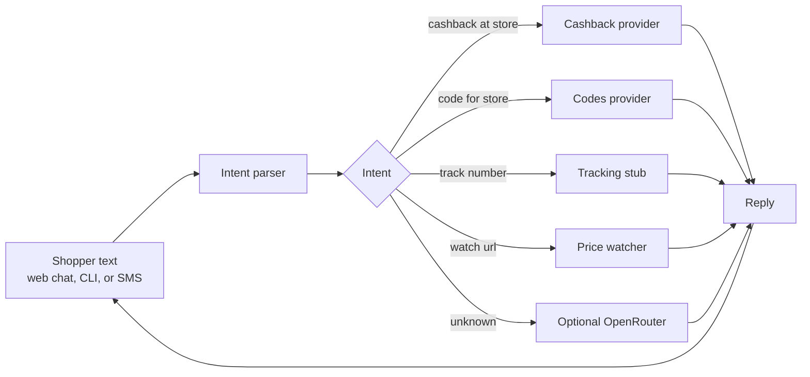

# Mate

<p align="center">
  
</p>

<p align="center"><strong>Your mate while you shop.</strong></p>

<p align="center">
  A shopping agent you text before you shop.<br />
  Live product: <a href="https://mate.fm/">mate.fm</a>
</p>

<p align="center">
  
</p>

This repository is the open-source **starter** for Mate: original icons in the mate.fm palette, a small runnable text agent, a web chat demo, docs for GitHub Pages, and clearly labeled demo providers. It is not the production service, and it is not connected to Mate’s live merchant network.

---

## What Mate is

From [mate.fm](https://mate.fm/):

> Your shopping agent with 200k merchant partnerships. Text Mate before you shop to save.
Cashback and codes are offered on request, wherever you shop online. The site lists, among others: Nature INT, NIKE, The New Yorker, Walmart, Dell, Cheerble, SEMrush, Verso, Casper, Slice, Charity: Water, MyFonts.

mate.fm marks its illustrated conversations as fictional. Example codes, deliveries and cashback on the marketing site — and every demo reply in this starter — are **not** real offers.

Get early access on [mate.fm](https://mate.fm/). Terms and privacy for the live product are published at [joincheckmate.com/terms-conditions](https://joincheckmate.com/terms-conditions) and [joincheckmate.com/privacy-policy](https://joincheckmate.com/privacy-policy).

---

## Features

Text Mate before you shop. Here’s what you get back — copied from the product site, with the original icons in this repo.

<table>
  <tr>
    <td width="56"></td>
    <td>
      <strong>01 · Cashback when you text first</strong><br />
      Text Mate before you buy. It sends you the link that tracks your order, and the cashback lands in your balance.
    </td>
  </tr>
  <tr>
    <td></td>
    <td>
      <strong>02 · Discount codes generated for you</strong><br />
      Tell Mate where you’re shopping. It gets you a discount code made just for you.
    </td>
  </tr>
  <tr>
    <td></td>
    <td>
      <strong>03 · Every package, tracked</strong><br />
      A text when it ships and when it’s at your door. Mate can tell your room-mate too.
    </td>
  </tr>
  <tr>
    <td></td>
    <td>
      <strong>04 · Price drop alerts</strong><br />
      Send Mate something you’re eyeing. It watches the price and texts you the moment it drops.
    </td>
  </tr>
</table>

The starter answers the same kinds of texts with **demo** data, always labeled `[demo]`.

---

## How it works



In production, those providers talk to Mate’s merchant network. In this repo they are **demo implementations**: placeholder links, `DEMO-…` codes, scripted shipment statuses, and a local price-watch job that does not scrape live product pages.

An optional OpenRouter LLM fallback (via `OPENROUTER_API_KEY`) only runs when the parser does not recognize an intent. No API keys are hardcoded.

---

## Quickstart

Python 3.10 or newer. No third-party packages are required at runtime.

```bash
git clone https://github.com/YOUR-USERNAME/mate.git
cd mate
python -m mate chat "cashback at Demo Shop"
python -m mate serve
```

Then open [http://127.0.0.1:8080](http://127.0.0.1:8080).

Useful commands:

```bash
python -m mate help
python -m mate "code for Demo Shop"
python -m mate "track DEMO-123456"
python -m mate "watch https://shop.example/nimbus-lamp"
python -m mate watch --simulate-drop
python -m unittest discover -s tests -v
```

Docker:

```bash
docker build -t mate-starter .
docker run --rm -p 8080:8080 mate-starter
```

---

## Setup and configuration

Copy [`.env.example`](.env.example) and export whatever you need. All settings are optional for the local demo.

| Variable | Default | Purpose |
| --- | --- | --- |
| `MATE_HOST` | `127.0.0.1` | Bind address for `python -m mate serve` |
| `MATE_PORT` | `8080` | Port |
| `MATE_DATA_DIR` | `data/` | JSON store for demo wallets, packages, watches |
| `OPENROUTER_API_KEY` | unset | Enables LLM fallback for unrecognized messages |
| `MATE_MODEL` | `openrouter/auto` | OpenRouter model id |
| `MATE_HTTP_REFERER` | `https://mate.fm` | Sent as `HTTP-Referer` to OpenRouter |
| `TWILIO_AUTH_TOKEN` | unset | Used only if signature checks are on |
| `TWILIO_VALIDATE_SIGNATURE` | `0` | Set to `1` to require a valid `X-Twilio-Signature` |

Point a Twilio number’s messaging webhook at `POST /webhooks/twilio`. The adapter is a stub: it reads `Body` and `From`, replies with TwiML, and never sends a real SMS by itself.

---

## Repository layout

```
mate/                 Python package (agent, server, providers, web chat)
tests/                unittest suite
docs/                 GitHub Pages landing site, in the mate.fm style
assets/brand/         Logo, app icon, favicon
assets/icons/         50 original SVG icons + PNG 64/128/512 + preview sheet
assets/social-preview.png
tools/generate_assets.py
```

The icon catalog, with names, lives in [`assets/icons/README.md`](assets/icons/README.md). Preview:


---

## Roadmap

- Swap demo providers for live Mate network adapters
- Persist shopper sessions beyond the local JSON store
- Richer tracking (carrier webhooks) behind the same intent interface
- A real price fetcher behind `PriceProvider`, still clearly separated from the demo
- iMessage / WhatsApp-style delivery in production stays on mate.fm; this starter keeps SMS and web

---

## Contributing

See [CONTRIBUTING.md](CONTRIBUTING.md) and the [Code of Conduct](CODE_OF_CONDUCT.md). Security reports go through [SECURITY.md](SECURITY.md).

## License

[MIT](LICENSE)

Product copy and the public store count above are taken from [mate.fm](https://mate.fm/). The logo mark matches the public mark at `https://mate.fm/icon.svg`. Icons in `assets/icons/` are original. This repo does not include third-party merchant logos.


